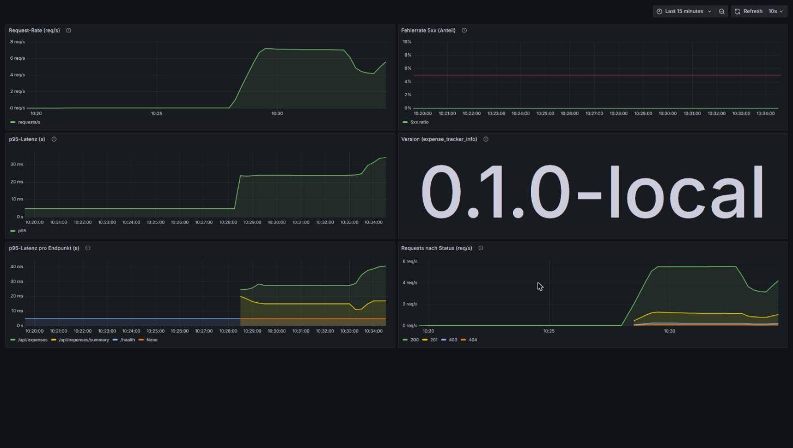
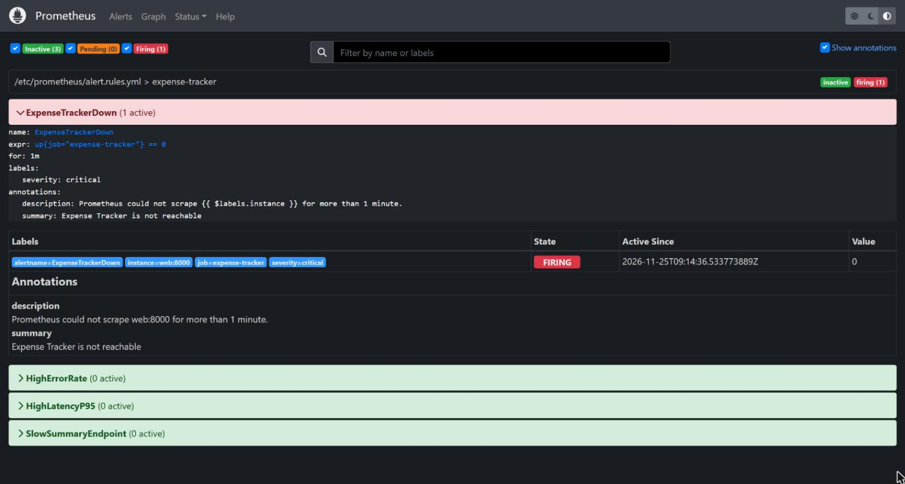

# Monitoring

This document describes what the Expense Tracker measures, what the Grafana
dashboard shows, when someone has to act and how the security scan works.
It is written so that someone who does not know the project can read the
dashboard and handle an alert.

## Scope

Prometheus and Grafana run locally next to the Docker Compose stack. They
scrape the `web` container. The public instance on Render (free plan) is not
scraped, there is no Prometheus server in the cloud. Render is watched by the
smoke test after every deploy (see [DEPLOYMENT.md](DEPLOYMENT.md)).

## Quick start

    make monitoring-up     # app, db, Prometheus and Grafana
    make load              # about 35 s of traffic, so the curves move
    make monitoring-down   # stop everything, data stays in the volumes

| What | URL | Login |
| --- | --- | --- |
| App | http://localhost:8000 | – |
| Prometheus targets | http://localhost:9090/targets | – |
| Prometheus alerts | http://localhost:9090/alerts | – |
| Grafana | http://localhost:3000 | `admin` / `admin` (local default, change with `GRAFANA_ADMIN_PASSWORD`) |

Prometheus and Grafana are bound to `127.0.0.1`, they are not reachable from
other machines.

Check that it works: on http://localhost:9090/targets the job
`expense-tracker` (endpoint `http://web:8000/metrics`) must be **UP**.

## Files

| File | Purpose |
| --- | --- |
| [`docker-compose.monitoring.yml`](docker-compose.monitoring.yml) | Adds Prometheus and Grafana to `docker-compose.yml` |
| [`monitoring/prometheus/prometheus.yml`](monitoring/prometheus/prometheus.yml) | Scrape targets, every 15 s |
| [`monitoring/prometheus/alert.rules.yml`](monitoring/prometheus/alert.rules.yml) | The four alert rules |
| [`monitoring/grafana/dashboards/expense-tracker-overview.json`](monitoring/grafana/dashboards/expense-tracker-overview.json) | The dashboard, loaded automatically when Grafana starts |
| [`monitoring/grafana/provisioning/`](monitoring/grafana/provisioning/) | Datasource and dashboard loader |
| [`scripts/load-test.sh`](scripts/load-test.sh) | Test traffic incl. some 400 and 404 answers |
| [`.github/workflows/trivy-scan.yml`](.github/workflows/trivy-scan.yml) | Security scan, see [Security scan](#security-scan-trivy) |

## Metrics

The app exposes its metrics on `/metrics` in the Prometheus format
(`prometheus-flask-exporter`).

| Metric | Type | Labels | Meaning |
| --- | --- | --- | --- |
| `flask_http_request_total` | Counter | `method`, `status` | Number of HTTP requests |
| `flask_http_request_duration_seconds` | Histogram | `method`, `status`, `url_rule` | Response time, buckets from 5 ms to 10 s |
| `expense_tracker_info` | Gauge | `version` | Always 1, the label shows the running version |
| `up` | Gauge | `job`, `instance` | Created by Prometheus: 1 = scrape worked, 0 = target not reachable |

`url_rule` is the route template (`/api/expenses/<int:expense_id>`), not the
real path (`/api/expenses/17`). With the real path every id and every random
URL would create a new time series. Unknown URLs are all counted as
`url_rule="None"`. This is set with `group_by="url_rule"` in
`app/__init__.py`.

`/metrics` itself is not counted.

## Dashboard "Expense Tracker Overview"



The values under "normal" were measured locally on 2026-11-25: once idle
(no traffic for more than 10 minutes) and once while `make load` was running.
All queries use a 5 minute window.

### Request rate (req/s)

| | |
| --- | --- |
| Metric | `flask_http_request_total` |
| PromQL | `sum(rate(flask_http_request_total[5m]))` |
| Question | How much traffic does the app get right now? (golden signal: traffic) |
| Normal | Idle about 0.03 req/s, that is only the Docker healthcheck on `/health` every 30 s. Under `make load` about 7 req/s on average over 5 minutes, up to 27 req/s over 1 minute. |
| Act when | The rate is 0 for several minutes while the container runs: then not even the healthcheck arrives, something between Docker and the app is broken. There is no upper limit to act on, a high rate alone is not a problem. Look at errors and latency instead. |

### Error rate 5xx (share)

| | |
| --- | --- |
| Metric | `flask_http_request_total` |
| PromQL | `(sum(rate(flask_http_request_total{status=~"5.."}[5m])) or vector(0)) / sum(rate(flask_http_request_total[5m]))` |
| Question | Which share of requests fails because of our service? (golden signal: errors) |
| Normal | 0 %. No 5xx was seen in any test run. |
| Act when | Above 5 % for 5 minutes (red line in the panel, alert `HighErrorRate`). Single 5xx can happen during a restart, 5 % over 5 minutes is a real problem for users. |

4xx answers are not counted, they are mistakes of the client (wrong input,
unknown id). `or vector(0)` shows 0 instead of "No data" while no 5xx has
happened yet: without a single 5xx the time series does not exist at all.

### p95 latency (s)

| | |
| --- | --- |
| Metric | `flask_http_request_duration_seconds_bucket` |
| PromQL | `histogram_quantile(0.95, sum by (le) (rate(flask_http_request_duration_seconds_bucket[5m])))` |
| Question | How long do the slowest 5 % of requests take? (golden signal: latency) |
| Normal | Idle 5 ms (only `/health`). Under load about 24 ms. |
| Act when | Above 1 s for 5 minutes (alert `HighLatencyP95`). That is 40 times the normal value and far above the latency SLO below. |

The p95 is estimated from the histogram buckets. Values inside a bucket are
interpolated, so 4.75 ms means "below the 5 ms bucket", not an exact value.

### Version (`expense_tracker_info`)

| | |
| --- | --- |
| Metric | `expense_tracker_info` |
| PromQL | `expense_tracker_info` |
| Question | Which version is running? |
| Normal | The version from `APP_VERSION`, locally `1.0.0-local`. |
| Act when | After a deploy the old version is still shown, or the panel is empty (target down). |

### p95 latency per endpoint (s)

| | |
| --- | --- |
| Metric | `flask_http_request_duration_seconds_bucket` |
| PromQL | `histogram_quantile(0.95, sum by (le, url_rule) (rate(flask_http_request_duration_seconds_bucket[5m])))` |
| Question | Which endpoint is slow? |
| Normal | Under load `/api/expenses` about 28 ms, `/api/expenses/summary` about 15 ms, `/health` 5 ms. `/api/expenses` returns all rows, it gets slower when the table grows (more than 1500 rows after several load tests). |
| Act when | `/api/expenses/summary` above 0.5 s for 10 minutes (alert `SlowSummaryEndpoint`), or one endpoint is more than 10 times slower than the others. |

### Requests by status (req/s)

| | |
| --- | --- |
| Metric | `flask_http_request_total` |
| PromQL | `sum by (status) (rate(flask_http_request_total[5m]))` |
| Question | Which answers does the app give? |
| Normal | Mostly 200 and 201. Under `make load` about 6 % 4xx, the load script sends wrong input (400) and unknown URLs (404) on purpose. |
| Act when | 5xx shows up (see error rate), or 4xx suddenly makes up most of the traffic: then probably a client sends wrong requests after a change of the API. |

## Service level objectives

Both SLOs are measured over 30 days. 30 days have 30 × 24 × 60 = 43 200
minutes.

### SLO 1: availability

- **SLI:** share of requests that do not end with a 5xx status.

      sum(increase(flask_http_request_total{status!~"5.."}[30d]))
        /
      sum(increase(flask_http_request_total[30d]))

- **SLO:** 99.5 % of the requests over 30 days.
- **Error budget:** 0.5 %.
  - As time: 0.5 % × 43 200 min = **216 min** (3 h 36 min) of full outage per
    30 days.
  - As requests: with about 10 000 requests per month (one person, a few
    hundred requests per day) 0.5 % × 10 000 = **50 failed requests**.
- **Why 99.5 % and not more:** the app runs as a single instance and is a
  personal tool. On Render the free plan goes to sleep and every deploy
  restarts the app. 99.9 % (43 min) would already be used up by a few
  deploys and restarts, and nobody loses money if the app is gone for an hour.

### SLO 2: latency

- **SLI:** share of requests that are answered in less than 250 ms
  (`le="0.25"` is one of the histogram buckets, so this is exact, not
  estimated).

      sum(increase(flask_http_request_duration_seconds_bucket{le="0.25"}[30d]))
        /
      sum(increase(flask_http_request_duration_seconds_count[30d]))

- **SLO:** 99 % of the requests faster than 250 ms over 30 days.
- **Error budget:** 1 % of the requests may be slower. With about 10 000
  requests per month that is **100 slow requests**.
- **Why this target:** 250 ms still feels instant for an API call. Locally
  100 % of the requests were below 250 ms (p95 24 ms), so there is a lot of
  room. Not 99.9 %: on Render the first request after the sleep takes up to a
  minute, a few of these per day must fit into the budget.

## Alerts

Prometheus evaluates the rules every 15 s and shows them on
http://localhost:9090/alerts. A rule goes from `inactive` to `pending` as soon
as its condition is true, and to `firing` when it stays true for the `for`
time. Alertmanager (sending mails or chat messages) is not set up, the alerts
are only visible in Prometheus.

| Alert | Condition | `for` | Severity |
| --- | --- | --- | --- |
| `ExpenseTrackerDown` | `up{job="expense-tracker"} == 0` | 1m | critical |
| `HighErrorRate` | 5xx share above 5 % | 5m | warning |
| `HighLatencyP95` | p95 above 1 s | 5m | warning |
| `SlowSummaryEndpoint` | p95 of `/api/expenses/summary` above 0.5 s | 10m | warning |

All rules react to symptoms a user notices (not reachable, errors, slow
answers), not to causes like CPU usage.

`HighErrorRate` stays silent without traffic: 0 / 0 is `NaN`, and `NaN > 0.05`
is false. A full outage is caught by `ExpenseTrackerDown`.

Tested on 2026-11-25: `docker compose ... stop web` at 10:14:16, the rule was
`pending` at 10:14:40 and `firing` at 10:15:40. After `start web` it was
`inactive` again at 10:16:36.



### Runbook

**ExpenseTrackerDown**

1. Meaning: Prometheus could not read `/metrics` for one minute. Users get no
   answer at all.
2. Check: `docker compose ps` (is `web` running?), `curl localhost:8000/health`.
3. Container stopped or restarting: `docker compose logs web` for the error
   (often the database, see `/ready`), then `docker compose up -d web`.
4. Container runs and `/health` answers, but the target is still down: check
   the target in `monitoring/prometheus/prometheus.yml` (`web:8000`, never
   `localhost`).

**HighErrorRate**

1. Meaning: more than 5 % of requests end with a server error.
2. Check: panel "Requests by status" shows which code (500, 503). `curl
   localhost:8000/ready`: 503 means the database is not reachable.
3. `docker compose logs web` shows the Python traceback.
4. Started right after a deploy: roll back (see DEPLOYMENT.md).

**HighLatencyP95**

1. Meaning: 5 % of the requests take longer than 1 s.
2. Check: panel "p95 latency per endpoint" shows which endpoint is slow. Is it
   all endpoints (database or host overloaded) or only one (that endpoint's
   query)?
3. `docker stats` for CPU and memory of `web` and `db`.

**SlowSummaryEndpoint** (own rule)

Why this rule: `/api/expenses/summary` adds up all expenses on every call, so
it is the first endpoint that gets slower when the data grows. Users notice
it as a slow monthly overview long before the other endpoints are affected.
0.5 s is about 30 times the value measured under load (15 ms) and half of the
general latency alert, so it fires earlier and points at the cause.
`for: 10m`, because only a lasting slowdown matters, not a single slow call
while a large insert is running.

```yaml
- alert: SlowSummaryEndpoint
  expr: |
    histogram_quantile(
      0.95,
      sum by (le) (rate(flask_http_request_duration_seconds_bucket{url_rule="/api/expenses/summary"}[5m]))
    ) > 0.5
  for: 10m
  labels:
    severity: warning
  annotations:
    summary: "Summary endpoint is slow"
    description: "p95 of /api/expenses/summary is {{ $value | humanizeDuration }} (threshold 0.5s) for 10 minutes."
```

1. Meaning: the summary endpoint is slow for 10 minutes, the other endpoints
   may still be fine.
2. Check if it is real: panel "p95 latency per endpoint". Is only
   `/api/expenses/summary` high, and is there traffic at all (a single slow
   request in a quiet period can lift the p95)?
3. Time it yourself: `time curl -s localhost:8000/api/expenses/summary`.
4. Check the amount of data: `curl -s localhost:8000/api/expenses | python3 -c
   "import json,sys; print(len(json.load(sys.stdin)))"`. Many rows: the sum
   should be calculated in SQL (`GROUP BY`) instead of in Python.
5. Few rows but still slow: check the database (`docker stats`,
   `docker compose logs db`).

## Security scan (Trivy)

The workflow [`.github/workflows/trivy-scan.yml`](.github/workflows/trivy-scan.yml)
runs on every pull request, on every push to `main` and every Monday. It is a
separate workflow next to `ci.yml` and shows up as the check "Trivy scan" in
every pull request.

| Step | What it does | Fails the job? |
| --- | --- | --- |
| Report all findings | Lists every finding of the image (all severities) in the log | never |
| Gate | `--severity HIGH,CRITICAL --ignore-unfixed --exit-code 1` | yes, on a HIGH or CRITICAL finding that has a fix |
| Secret scan | `trivy fs --scanners secret` over the repository | yes, on any found secret |

**Threshold:** the pipeline fails on HIGH and CRITICAL findings for which a
fixed version exists. Findings without a fix do not fail it, nobody could fix
them, and an always red gate gets ignored. The reasons and the alternatives
are in [ADR 0004](docs/adr/0004-trivy-gate-threshold.md).

To keep the gate green, the Dockerfile installs Debian security updates
(`apt-get upgrade`) and removes `pip` from the runtime image.

Run it locally (Trivy from its Docker image, no installation needed):

    make docker-build
    docker run --rm -v /var/run/docker.sock:/var/run/docker.sock \
      aquasec/trivy:0.76.2 image --severity HIGH,CRITICAL --ignore-unfixed \
      --exit-code 1 expense-tracker:local
    echo $?   # 0 = gate passed, 1 = at least one fixable finding

### Result on 2026-11-25

| | before | after the Dockerfile change |
| --- | ---: | ---: |
| HIGH or CRITICAL with a fix | 1 (`libzstd1`) | 0 |
| Findings in Python packages | 6 (all in `pip`) | 0 |
| HIGH without a fix | 54 | 53 |
| CRITICAL | 0 | 0 |
| Gate exit code | 1 | 0 |

All remaining findings are in Debian packages of the base image and have no
fix yet. The three most severe (CVSS v3):

**1. CVE-2026-16742, `libsystemd0` (systemd), HIGH, CVSS 8.8, no fix**

- Local privilege escalation in `systemd-homed` (missing signature check of
  home records).
- In this app: only the library `libsystemd0` is in the image. There is no
  systemd in the container (process 1 is Gunicorn) and no `systemd-homed`
  daemon. An attacker would need a shell in the container first, and our
  endpoints only take JSON with an amount, a category and a date. The process
  runs as `appuser`, not root.
- Recommendation: accept and keep watching. As soon as Debian ships a fix the
  gate turns red and a new build (`apt-get upgrade`) fixes it.

**2. CVE-2026-78408, `util-linux` (`nsenter`), HIGH, CVSS 7.9, no fix**

- `nsenter --join-cgroup` leaks the right to move processes into the root
  cgroup.
- In this app: `nsenter` is in the image but is never started, neither by the
  app nor by the Dockerfile. Using it needs a shell in the container and extra
  capabilities that the container does not have (non-root,
  `allowPrivilegeEscalation: false` in Kubernetes).
- Recommendation: accept and watch. The other three `util-linux` findings
  (CVE-2026-76642, -78409, -78410) are about `mount` and have the same
  assessment.

**3. CVE-2026-119374, `libsqlite3-0` (SQLite), HIGH, CVSS 7.8, no fix**

- Code execution when SQLite opens a database with a corrupted FTS5 index.
- In this app: the library is there because Python's `sqlite3` module needs
  it. The app never imports `sqlite3`, it stores data in Postgres or in memory,
  and there is no endpoint that accepts a file. An attacker cannot get a
  database file to SQLite.
- Recommendation: accept and watch. The same applies to the other two SQLite
  findings (CVE-2026-119373, -119379).

The other HIGH findings: OpenSSL (CVE-2026-107494, -124709) only affects QUIC,
which the app does not use. `ncurses`, `acl` and `perl` are tools the app
never runs.

## Secrets

| Secret | Where it lives |
| --- | --- |
| Render deploy hook | GitHub Actions secret `RENDER_DEPLOY_HOOK` |
| Postgres password in Kubernetes | Secret created in the cluster by `make k8s-secret`, random ([ADR 0003](docs/adr/0003-kubernetes-secret-outside-git.md)) |
| Postgres password in Docker Compose / Terraform | `POSTGRES_PASSWORD` / `db_password` from the environment or a git-ignored file. The default `changeme` is only for local use, the database port is not published. |
| Grafana admin password | `GRAFANA_ADMIN_PASSWORD`, local default `admin`, only reachable on `127.0.0.1` |

Checked on 2026-11-25: `gitleaks git` over the whole history (gitleaks
v8.30.1) found no leaks. The secret scan in the Trivy workflow checks every
new pull request.

## Known pitfalls

- **Rate is 0 after a short load test.** `rate()` needs two scrapes with an
  increase in between. If all requests happen within one scrape interval
  (15 s), the curve stays flat. `make load` runs for about 35 s for this
  reason.
- **Curves jump with several Gunicorn workers.** Every worker counts on its
  own and Prometheus reads a random one. The monitoring stack sets
  `GUNICORN_WORKERS=1`.
- **Grafana shows an old dashboard or Prometheus old rules after a branch
  switch.** The config folders are bind mounts. If Git deletes and creates
  the folder again, the running container still sees the old folder, and a
  restart is not enough. Fix: `docker compose -f docker-compose.yml -f
  docker-compose.monitoring.yml up -d --force-recreate prometheus grafana`.
