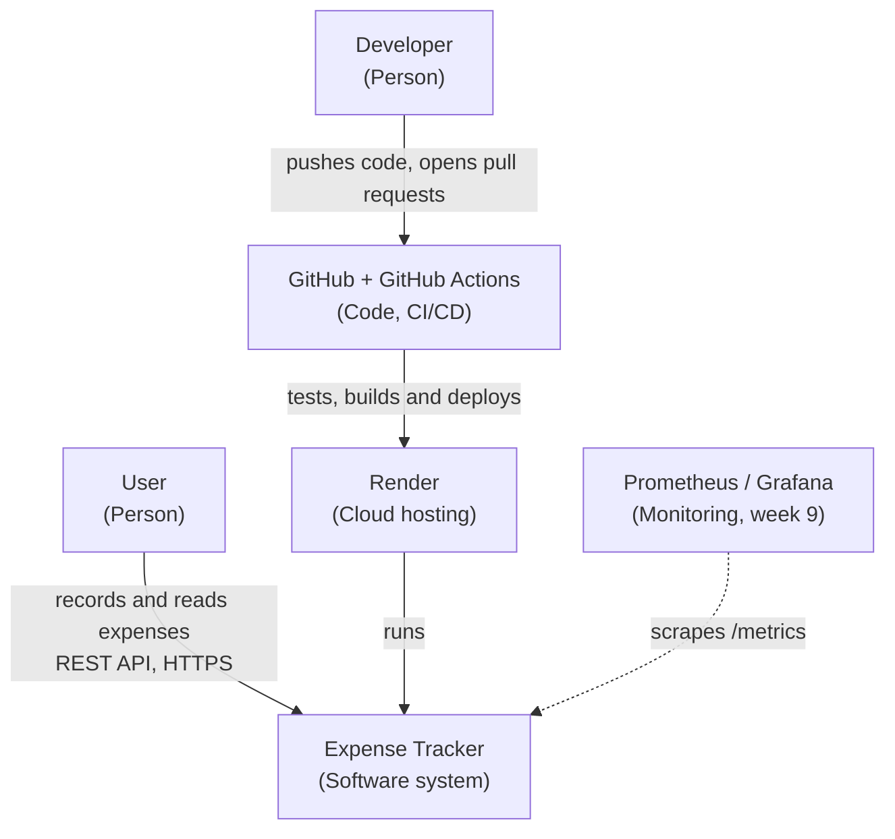
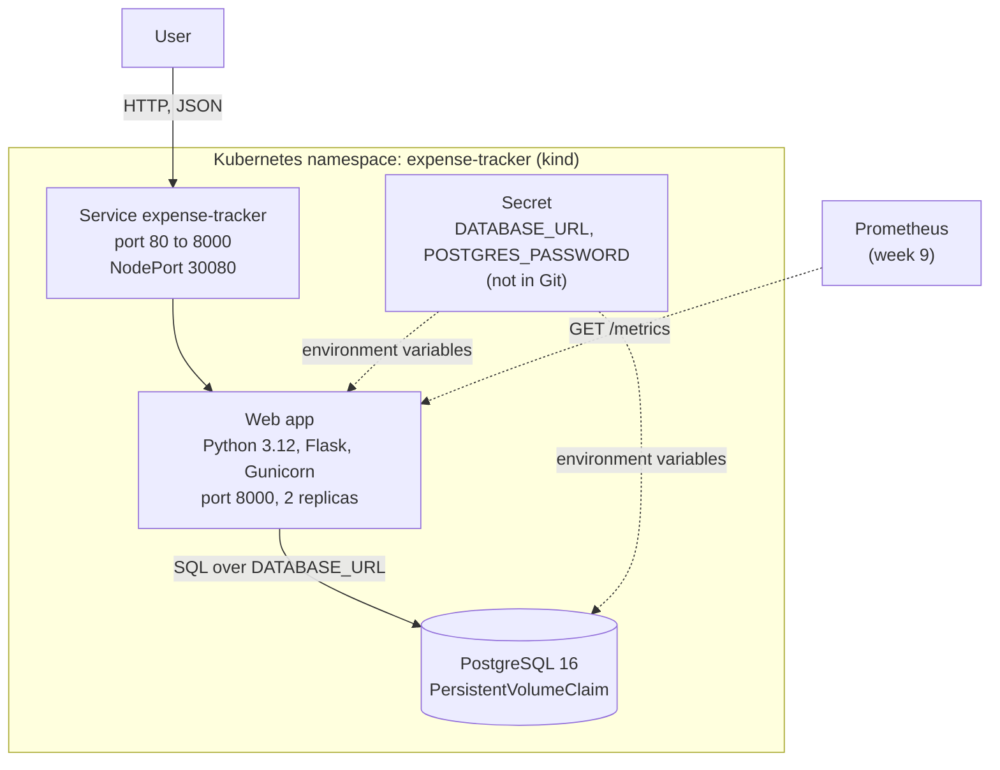

# Architecture

## Overview

The expense tracker is one Flask app (served by Gunicorn on port 8000) and one
PostgreSQL 16 database. The app talks to the database only through
`DATABASE_URL`; without it the app uses an in-memory store. The same Docker
image runs in four places: Docker Compose (local development), Terraform
(local, IaC), a kind cluster (Kubernetes) and Render (public URL). GitHub
Actions tests and builds every change and starts the deploy to Render.

The main decisions are written down as ADRs in [docs/adr/](adr/).

## C4 level 1: context

Who uses the system and which other systems does it talk to?

## C4 level 2: containers

Which separately deployable parts does the system have? The diagram shows the
Kubernetes setup, it is the most complete one (two app replicas).

The same containers in the other environments:

| Environment | Web app | Database | Started with |
| --- | --- | --- | --- |
| Docker Compose | service `web`, port 8000 | service `db`, volume `db-data` | `make up` |
| Terraform | container `expense-tracker-tf-web`, port 8080 | container `expense-tracker-tf-db` | `terraform apply` |
| Kubernetes (kind) | Deployment, 2 replicas, NodePort 30080 | Deployment + PVC | `make k8s-deploy` |
| Render | web service, free plan | none, in-memory store | merge to `main` (CD workflow) |

## Health endpoints

| Path | Meaning | Used by |
| --- | --- | --- |
| `/health` | the process runs (no database check) | liveness probe, Render health check, Docker healthcheck |
| `/ready` | the app can reach its database | readiness probe, smoke test |
| `/metrics` | Prometheus metrics | Prometheus (week 9) |

## Main decisions

| Topic | Decision | ADR |
| --- | --- | --- |
| Database | Postgres everywhere with more than one process, in-memory only on Render | [0001](adr/0001-postgres-in-cluster-in-memory-on-render.md) |
| Terraform | Terraform uses the image from `make docker-build`, it does not build it | [0002](adr/0002-terraform-uses-prebuilt-image.md) |
| Secrets | The Kubernetes Secret is created in the cluster, not stored in Git | [0003](adr/0003-kubernetes-secret-outside-git.md) |
